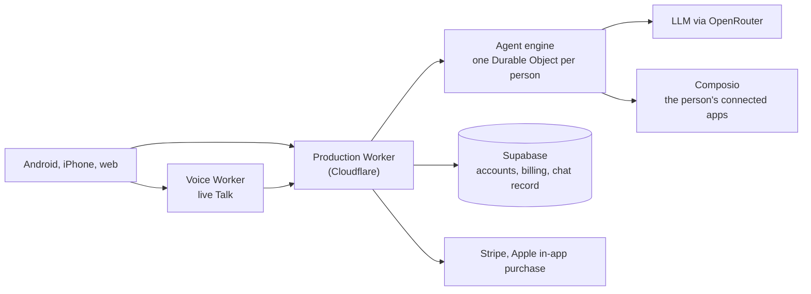

# Delegent AI

An open-source AI coworker in your pocket. You chat with it, dictate to it or
talk to it, and it gets things done: it reads and answers email, sorts your
inbox, finds money you might be owed (delayed-flight compensation, forgotten
refunds, unwanted subscriptions), plans trips, writes letters and PDFs, and
works inside 35 connected apps such as Gmail, Outlook and Google Calendar.
Anything that would send, post or spend waits for your yes.

It is a complete, production-grade stack: Android and iOS apps from one
codebase, a web app, a marketing site, and a Cloudflare Workers backend with
one Durable Object per person. It ran in production on Google Play and the App
Store in 2026, with card and Apple in-app billing, and was built by one
developer working with AI agents.

## Open for contributors

This project is looking for contributors. Whether you want to self-host your
own AI coworker, swap in a different model, improve the apps or just learn
from a real end-to-end agent product, you are welcome.

- **Start here:** issues labelled
  [`good first issue`](https://github.com/henryrocks7800/delegent-ai/labels/good%20first%20issue)
  and [`help wanted`](https://github.com/henryrocks7800/delegent-ai/labels/help%20wanted).
- **Questions and ideas:** [Discussions](https://github.com/henryrocks7800/delegent-ai/discussions).
- **How to contribute:** see [`CONTRIBUTING.md`](CONTRIBUTING.md). Fork, branch,
  keep `npm run test` green, open a pull request.

Good places to help right now: a one-command local setup, running on a local
or any OpenAI-compatible model, and a Docker Compose setup for self-hosting.

To run it you need your own Supabase project, Cloudflare account and model
provider; see "Running it yourself" below.

## The system at a glance



Three Cloudflare Workers do all server-side work:

- the **production Worker** (`apps/worker`): every API route, the only holder of
  server secrets, and the check on every subscription and usage allowance;
- the **agent engine** (`apps/agent`): the coworker itself, one Durable Object
  per person holding their conversation and memory, the model loop, tools and
  connected apps, plus Cloudflare Workflows for long jobs such as bulk inbox
  sorting;
- the **voice Worker** (`apps/agent/voice`): live speech in and out, turning
  spoken sentences into ordinary chat turns.

Supabase holds accounts, billing state and the chat record the app displays.
The apps hold nothing but the public Supabase key and the person's own session.
The full picture, with a diagram of every flow, is
[`docs/ARCHITECTURE.md`](docs/ARCHITECTURE.md); the visual design language is
[`docs/DESIGN.md`](docs/DESIGN.md).

## What is in this repo

| Path | What |
|---|---|
| `apps/mobile` | Expo / React Native app for Android and iOS from one codebase. The chat screen is a WebView authored in `assets/chat-webview/index.html` and compiled by `npm run chat:regen` |
| `apps/webapp` | The web app (Vite, React), including an admin dashboard of real unit economics |
| `apps/website` | The marketing site, help articles and legal pages |
| `apps/worker` | The production Cloudflare Worker: chat runs over SSE, allowance and top-ups, Stripe and Apple billing, OAuth connections, push, account export and deletion |
| `apps/agent` | The agent engine Worker and its model evaluation harness (`eval/`); `voice/` is the voice Worker |
| `packages/shared` | Product copy, legal text, the plan, the connections catalogue, shared types |
| `packages/billing` | Stripe events to subscription state |
| `supabase/migrations` | The database schema, with row-level security on every table (validated by `npm run test:supabase`) |
| `tests/` | End-to-end contracts, release gates and security checks |
| `services/hermes-runner`, `packages/provisioner`, `apps/web` | The first architecture, retired in September 2026: a private Fly.io machine per subscriber running the open-source Hermes agent, provisioned on payment. Kept for the record |

The repo still uses the prototype's names (`sidekick-v2`, `@sidekick/*`,
`com.sidekick.v2`); the product was always called Delegent AI.

## Build and test

Node 22 and npm 10.

```bash
npm install
npm run typecheck
npm run lint
npm run build
npm run test
```

Worker tests run against built output, so build before testing a single
workspace (`npm run build --workspace @sidekick/worker`, then
`npm test --workspace @sidekick/worker`).

## Running it yourself

You will need your own accounts and must set every value yourself; nothing in
this repo points at a working service any more.

1. **Supabase:** create a project, apply `supabase/migrations/*.sql` in order.
2. **Cloudflare:** deploy `apps/agent` (the engine) first, then `apps/worker`,
   then `apps/agent/voice`. Replace the account, route and domain values in
   `apps/worker/wrangler.toml` and `apps/agent/wrangler*.jsonc` with your own,
   and set the secrets listed in `.env.example` with `wrangler secret put`.
3. **Mobile:** copy `.env.public.example`, fill in your public values, add your
   own Firebase `google-services.json` and `GoogleService-Info.plist` in
   `apps/mobile`, set your own Expo project in `apps/mobile/app.json` and
   `app.config.ts`, then build with EAS.
4. **Billing** is optional: without Stripe keys the paid routes simply refuse.

Identifiers left in the code (domains, project ids, store ids) belonged to the
original deployment and no longer work; replace them with yours.

## Licence

MIT, see [`LICENSE`](LICENSE). Third-party services named here are trademarks
of their owners.
