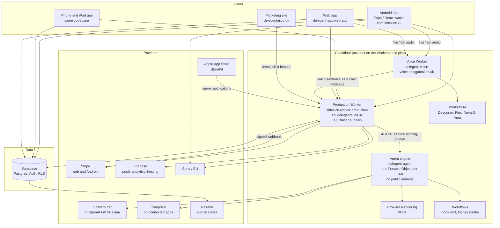
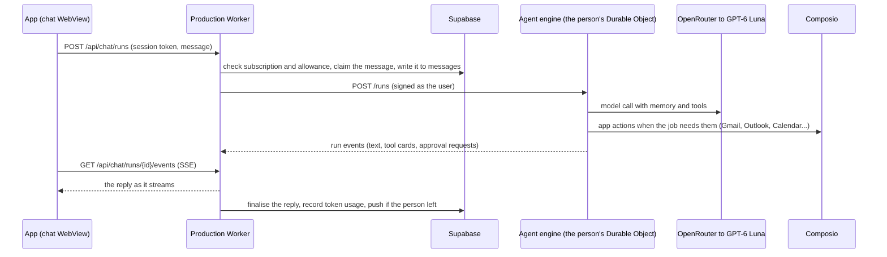
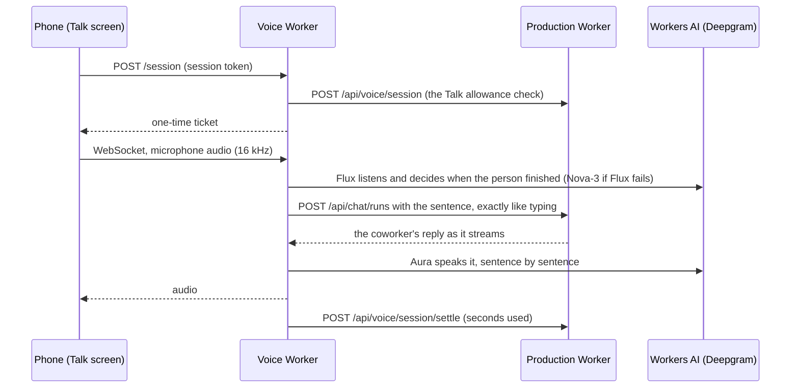
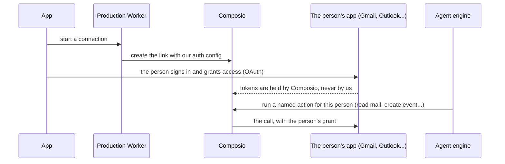

# Architecture

How Delegent AI is put together as at **2026-09-30**. This describes the system
that runs today: every account on the **agent engine**, one £3.99 plan, live Talk
on Android and the web. The per-user Fly "runner" design that came before it was
retired on 2026-09-18; its documents are in `docs/archive/`.

> **Public copy note (November 2026).** This is the internal architecture
> document as it stood when the service was live. It refers in places to
> operating documents, deploy scripts and the secrets vault (`START_HERE.md`,
> `OPERATIONS.md`, other `docs/*.md`, `scripts/ops/`, Doppler) that were part
> of the original deployment and are not included here. None of the hosts or
> ids named below are live; use your own.

---

## 1. The whole system on one page

**The one rule that explains most of the design:** the apps hold nothing but the
public Supabase key and the person's own session. Every secret (the model key,
Stripe, Composio, the service-role key) lives in a Cloudflare Worker, and every
request that spends money or touches another service goes through the
production Worker, which checks the subscription and the allowance first.

---

## 2. The parts

| Part | Where in the repo | Runtime | Deploy | What it does |
|---|---|---|---|---|
| Mobile app | `apps/mobile` | Expo SDK 55, React Native, New Architecture | JS over the air with `node scripts/ops/publish-ota.mjs --platform <android\|ios>`; native builds through EAS (`START_HERE.md` §7) | The product. The shell is `App.tsx`; the chat is a WebView authored in `assets/chat-webview/index.html` (compiled to `src/chat/chatWebViewHtml.ts` by `node scripts/regen-chat-webview-html.js`) |
| Web app | `apps/webapp` | Vite, React | `doppler run -p delegent-ai -c prd -- npm run webapp:deploy` (Firebase Hosting) | The same account in a browser, including the same chat document and `/admin` (Alex's dashboard) |
| Marketing site | `apps/website` | Vite, React, prerendered help pages | `doppler run -p delegent-ai -c prd -- npm run website:deploy` (Firebase Hosting) | `delegentai.co.uk`, legal pages, `/help`, and `/install`, which records an ad click and hands the visitor to the right store |
| Production Worker | `apps/worker` | Cloudflare Worker | `cd apps/worker && npx wrangler deploy --env production` (**always** `--env production`: a stale `sidekick-worker` also exists) | Every API route: chat runs, allowance, Stripe checkout and webhook, Apple IAP, connections, push, Talk minutes, account export and deletion, admin, referrals, top-ups, install attribution |
| Agent engine | `apps/agent` | Cloudflare Worker with Durable Objects (Project Think), Workflows, Browser Rendering, Images | `cd apps/agent && npx wrangler deploy --var 'INBOX_SORT_USER_IDS:*' --var 'MONEY_FINDER_USER_IDS:*'` (a plain deploy switches both features off) | The coworker itself: model loop, memory, tools, Composio actions, PDFs, chat attachments, inbox sorting, Money Finder |
| Voice Worker | `apps/agent/voice` | Cloudflare Worker with a Durable Object, Workers AI | `cd apps/agent && npx wrangler deploy -c wrangler.voice.jsonc --var SUPABASE_ANON_KEY:<public anon key>` | Live Talk: listens, sends each sentence to the coworker as a chat message, speaks the reply. Run book: `apps/agent/voice/README.md` |
| Shared library | `packages/shared` | TypeScript | built by the workspaces | Product copy, legal text (terms, privacy), the plan (`AGENT_PLAN`), connections catalogue, validation, quota journey |
| Billing library | `packages/billing` | TypeScript | built by the workspaces | Turns Stripe events into subscription state; top-up records |
| Database | `supabase/migrations` | Supabase Postgres | migrations applied with the script named in each release note, then verified | Accounts, subscriptions, allowance, the chat display record, usage ledger, attribution |

Still in the repo but not part of the live product (kept because tests or history
depend on them, not because anything runs them):

| Part | State |
|---|---|
| `services/hermes-runner`, `packages/provisioner` | The retired per-user runner and its Fly provisioner. The hourly GitHub Actions job (`series4-cron.yml`) still runs the account-lifecycle steps that use the provisioner package (account-deletion teardown, dunning reconciliation); there are no runners left to provision |
| `apps/web` | Next.js API routes from before the Worker took them over. No deploy script; Stripe checkout and the webhook are served by the Worker at `/api/stripe/webhook` |
| `desktop/` | A Windows client, parked since 2026-07-29. Do not ship it |
| Telegram | The webhook is on in production, but every account is on the engine, so the bot answers each message by pointing to the app (`TELEGRAM_MOVED_TO_APP_REPLY`, since 2026-09-23). It is not a working channel. WhatsApp and Signal were never switched on |

---

## 3. How a chat message travels

- **The chat record has two copies with different jobs.** Supabase `messages` is
  what the app draws. The engine's Durable Object (SQLite) holds what the model
  sees: the conversation, a memory block, and archived earlier conversations it
  can search. Reasoning about what the coworker remembers from the `messages`
  table is reasoning about the wrong store.
- **Irreversible actions ask first.** For sending, paying, posting or changing an
  account, the engine ends its reply with an approval card; the app posts the
  answer to `/api/chat/approval` and the same turn continues.
- **Long conversations are compacted** inside the engine; the display record is
  never shortened.

## 4. How live Talk works (Android and the web, beta since 2026-09-28)

Because each sentence is an ordinary chat message, Talk uses the same model,
memory, tools, approvals and allowance as typing, and the conversation appears in
the chat. On iPhone, Talk is still the first version (a separate OpenAI realtime
model that files the request as a chat message), because the iPhone WebView cannot
cancel echo. `LIVE_TALK_ENABLED:false` on the voice Worker sends everyone back to
that version with no app update.

## 5. How an app connection works

The catalogue is `packages/shared/src/connections.ts`: **35 apps through Composio**.
FreeAgent, Yahoo Mail and AOL are on our own broker in the Worker; FreeAgent served
the retired runners and Yahoo and AOL are built but switched off, so on the engine
every working connection is a Composio one. Shipping a connection means updating the
privacy policy in the same change (the policy names every provider). Adding one:
`docs/ADDING_A_COMPOSIO_CONNECTOR.md`.

## 6. How money comes in

| Where the person subscribes | Path |
|---|---|
| Android and the web | The app opens Stripe Checkout from `POST /api/stripe/checkout` (price lookup key `delegent_assistant_monthly`, a 30-day free month for anyone with no history, card taken up front). Stripe's signed webhook (`/api/stripe/webhook`) writes the subscription; the app never marks itself paid |
| iPhone and iPad | StoreKit in-app purchase (`com.sidekick.v2.assistant.monthly`), verified by the Worker with Apple's App Store Server API; Apple's server notifications keep it current. Apple keeps 15% |
| Top-ups | £1 packs after the monthly allowance is used, through Stripe Checkout (`kind=usage_top_up`), expiring after 12 months |
| Referrals | A Stripe member's invite code gives the friend's referrer one month's credit (£3.99) on the friend's first paid invoice; 12 a year; not on iPhone |

The plan itself is `AGENT_PLAN` in `packages/shared/src/content/agentEngine.ts`.
Pricing and unit economics: `docs/PRICING_AND_UNIT_ECONOMICS.md`.

## 7. Sign-in

Supabase Auth, three ways: Google (native on Android), Sign in with Apple (iPhone,
required by App Review), and an emailed one-time code (sent through Resend SMTP,
Supabase's own mailer as the fallback). The app gets a session and the public
anon key; Row Level Security limits every table it can read to the person's own
rows, and anything wider goes through the Worker with the service-role key.

## 8. Where data lives

| Store | What | Notes |
|---|---|---|
| Supabase Postgres (EU) | Accounts, profiles, subscriptions, allowance (`usage_quotas`), the usage ledger (`token_usage_events`), the chat display record (`messages`, `task_runs`), connections, push tokens, attribution, billing events | Migrations in `supabase/migrations`, head read live with `ls supabase/migrations/*.sql \| tail -1` |
| Agent engine Durable Objects | Per person: the conversation the model sees, the memory block, archived conversations, chat attachments, inbox-sort and Money Finder results | Wiped on account deletion (`DELETE /account`) |
| Voice Worker Durable Object | Nothing lasting: a one-time call ticket for a minute, and the voice kit's own transcript, wiped at the end of each call | The words live in the chat |
| Composio | The OAuth grants for connected apps | Revoked when the person disconnects |
| Stripe, Apple | Payment details | We never see a card |

Retention, deletion and the export are described in the privacy policy
(`packages/shared/src/legal/privacy.ts`) and the operations repo's GDPR pack.

## 9. Who may hold what

| Party | May hold |
|---|---|
| Mobile and web apps | The Supabase anon key and the person's own session. Nothing else |
| Production Worker | Everything server-side: Supabase service role, Stripe, Apple keys, Composio, FCM, Sentry, the engine shared secret, Talk's OpenAI key |
| Agent engine | The model key (OpenRouter), Composio, the engine shared secret |
| Voice Worker | The public anon key only; it acts with the person's own session, passed to it once per call |

Secrets live in Doppler (`delegent-ai` / `prd`) and are copied to each Worker as
Cloudflare secrets and to GitHub Actions as repository secrets. How:
`docs/SECRETS_OPERATOR_GUIDE.md`.

## 10. Scheduled work

| What | Where | When |
|---|---|---|
| Sweeps: stale chat runs, scheduled tasks, ending free trials, nurture emails, unfinished account deletions, expired connection codes and flows | Production Worker cron (`scheduled()` in `apps/worker/src/index.ts`) | every 5 minutes |
| Account lifecycle (deletion teardown, dunning reconciliation) | GitHub Actions `series4-cron.yml` | hourly, plus a daily dunning pass |
| Live smoke of every endpoint | GitHub Actions `live-smoke.yml` | every 6 hours |
| Deep health (Supabase, OpenRouter, the engine) | GitHub Actions `uptime-monitor.yml` | every 5 minutes (GitHub runs it roughly hourly in practice) |
| Credential expiry guard | GitHub Actions `credential-expiry-check.yml` | daily |
| Model watch | GitHub Actions `model-watch.yml` | weekly |
| Inbox sorting and Money Finder runs | Cloudflare Workflows in the engine | on request |

## 11. Watching it

Sentry (EU, org `your-org`) for the app and the Worker; the uptime and
smoke workflows open a GitHub issue on failure; `node scripts/internal/release-smoke-live.mjs`
after every deploy; `npx wrangler tail` on any Worker for live logs; Alex's
`/admin` page in the web app for customers, revenue and costs.
